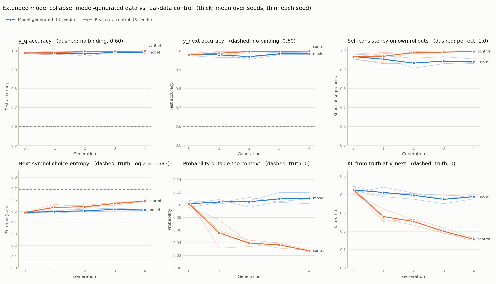

# ICL Induction-Head Baseline (PyTorch)

This repository is a compact baseline for the Wits NLP Project 1 task:
build a Transformer that learns a symbol-based in-context learning task,
then move toward reproducing the Singh et al. (2024) induction-head setup.
It also includes the Base Model Collapse pipeline , which recursively
retrains this Transformer on its own model-generated data to study model collapse.

## What the model learns

Each sequence is:

    exemplar_1, label_1, exemplar_2, label_2, ..., query_exemplar

The query repeats one of the context classes. Labels are randomly reassigned
for every sequence, so the network cannot solve the task by memorising a
global class->label map. It has to recover the mapping from the current context.

For K=2:

    A, 3, B, 1, A  -> target 3

A different sequence may use:

    A, 0, C, 4, A  -> target 0

## Architecture

- causal Transformer
- 2 layers
- 8 heads
- d_model = 64
- RoPE
- attention-only blocks (no MLP)
- LayerNorm + residual connections
- classify from final query position

These choices match the important defaults used by the Singh et al. codebase.
The same architecture and hyperparameters are reused, unchanged, for the
Model Collapse experiment below.

## Install

    python -m venv .venv
    # Linux/macOS
    source .venv/bin/activate
    # Windows
    .venv\Scripts\activate

    pip install -r requirements.txt

## 1. Fast symbolic sanity check

    python src/train.py --config config_symbolic.yaml

Expected behaviour:
- with 5 labels, chance accuracy is 20%
- validation accuracy should rise well above chance
- use this mode to debug the pipeline before expensive reproduction runs

Then:

    python src/plot_metrics.py --csv results/symbolic_metrics.csv
    python src/inspect_attention.py --checkpoint checkpoints/symbolic_baseline.pt

## 2. Singh-style Omniglot-feature run

Download/copy the authors' supplied file:

    omniglot_resnet18_randomized_order_s0.h5

to:

    data/omniglot_resnet18_randomized_order_s0.h5

Then run:

    python src/train.py --config config_singh.yaml

The Singh main-paper command uses:
- 1,000,000 iterations
- batch size 32
- learning rate 1e-5
- context length 2
- 5 random labels
- d_model 64
- default depth 2
- default 8 attention heads
- default RoPE
- attention-only model

IMPORTANT:
This project is a compact PyTorch reimplementation of the core task/architecture,
not a bit-for-bit port of the authors' JAX/Equinox code. For strict numerical
reproduction of their paper figures, run their official repository's
`ih_paper_runs.sh`.

## 3. Base Model Collapse 

This experiment recursively retrains the same Transformer on data it generated
itself, to study whether/how in-context learning behaviour degrades over
generations.

Pipeline:

    Data^0 (real, true labels)          -> train Model_0 -> eval on fixed val/test
    Data^1 (labeled by Model_0)         -> pool = D0+D1   -> train Model_1 (fresh init)
    Data^2 (labeled by Model_1)         -> pool = D0+D1+D2 -> train Model_2 (fresh init)
    ...

Key design points:
- Only the **target** is model-generated each generation; the context (classes
  and true random label assignment) is always sampled from the original true
  distribution. This isolates model error as the sole source of collapse.
- The training pool **accumulates** across generations (D0 ∪ D1 ∪ ... ∪ Di),
  matching the assignment's model-collapse pipeline figure.
- Validation and test sets are sampled **once** from the true distribution and
  reused unchanged for every generation, so results are directly comparable
  across generations.
- Each generation's model is **freshly initialized** and trained from scratch
  on that generation's accumulated pool (no warm-starting from the previous
  generation's weights).
- Architecture and all baseline hyperparameters (d_model, num_heads, depth,
  batch_size, lr, train_steps, etc.) are identical to `config_symbolic.yaml`.

Run it with:

    python src/train_collapse.py --config config_collapse.yaml

Number of generations, per-generation dataset size, and fixed val/test sizes
are set in `config_collapse.yaml` (`num_generations`, `train_pool_size`,
`val_size`, `test_size`).

Outputs:
 
    data/collapse/gen_<i>_train.pt              - each generation's training data
    data/collapse/fixed_val.pt                  - fixed validation set (all generations)
    data/collapse/fixed_test.pt                 - fixed test set (all generations)
    checkpoints/collapse/collapse_gen_<i>.pt     - model weights per generation
    results/collapse_metrics.csv                - step-level train/val metrics
    results/collapse_metrics_test_summary.csv    - per-generation test loss/acc/
                                                    perplexity and label agreement
                                                    with the true labels
 
### Plotting collapse results
 
    python src/plot_collapse_metrics.py --csv results/collapse_metrics.csv
 
Requires matplotlib and pandas (`pip install matplotlib pandas` if not already
in your environment). This reads both `results/collapse_metrics.csv` and
`results/collapse_metrics_test_summary.csv` and produces:
 
    results/collapse_train_loss.png       - train loss curves, all generations overlaid
    results/collapse_val_loss.png         - val loss curves, all generations overlaid
    results/collapse_val_acc.png          - val accuracy curves, all generations overlaid
    results/collapse_test_summary.png     - test accuracy / test loss / label agreement
                                             vs. generation (the main collapse result,
                                             three panels side by side)
 
`collapse_test_summary.png` is the figure most likely to go in the extended
abstract, since it directly shows whether accuracy degrades, stays flat, or
improves as synthetic data accumulates across generations.
 
## 4. Extended Model Collapse

The base task asks for one token, and that token is deterministic given the
context. Recursive training can therefore only corrupt *correctness* — there is
almost no distributional information to lose, which is why the base pipeline is
not expected to collapse much.

The extended task asks for **three** tokens. Given the same context, the model
predicts the query's label, then **the next symbol in the sequence**, then
**that symbol's corresponding value**:

    pos:   0    1    2    3    4     5      6       7
    tok:   x1   y1   x2   y2   xq  | y_q   x_next  y_next
    pred:                       ^     ^      ^

The middle token is the point of the exercise. Which symbol comes next is a coin
flip between the context symbols, so it carries a real distribution — and
recursive self-training can distort it, either by hardening the coin flip into
a fixed choice or by leaking probability to symbols that were never in the
context. The task, architecture and optimiser settings are identical to
`config_collapse.yaml`, so base vs. extended is a controlled comparison in which
the main difference is whether the output carries a distribution at all. (The
extended pipeline also selects checkpoints on held-out data, which the base
pipeline does not yet do — see [Methodological revisions](#methodological-revisions).)

### Task definition

Tokens live in one joint vocabulary of size `num_classes + num_labels`: symbol
`c` is id `c`, label `l` is id `num_classes + l`. This is exactly the layout the
existing one-hot input encoding already uses, so the output head is the dual of
the input embedding and the architecture barely changes.

- `y_q` — the query class's within-sequence label (deterministic).
- `x_next` — uniform over the K context classes, **including the query class**.
- `y_next` — the within-sequence label of `x_next` (deterministic given
  `x_next`, and recoverable only by the induction circuit).

Including the query class in `x_next` is not a detail. With `K = 2`, excluding
it would make `x_next` deterministic — only one other class is left to pick —
the token-2 loss floor would be zero, and there would be no distribution for
collapse to contract.

Per sequence, the truth is uniform over the K context symbols. That gives exact
analytic reference values, which every figure draws as a dashed rule:

| Quantity | True value (K=2, 50 symbols, 5 labels) | What moves it |
|---|---|---|
| next-symbol choice entropy | `log K` = 0.693 nats | falls as the model commits to a favourite |
| probability on the preferred context symbol | `1/K` = 0.50 | rises as the model commits |
| probability outside the context | 0 | rises as errors leak into the data |
| KL from the truth at `x_next` | 0 | both of the above |
| token-2 CE floor | `log K` = 0.693 nats | |
| token-2 accuracy ceiling | `1/K` = 0.50 | |
| token-1 / token-3 chance | `1/L` = 0.20 | guessing a label |
| token-1 / token-3 without binding | `1/K + (1−1/K)/L` = 0.60 | copying a random context label |

The last row is the baseline that matters for the label tokens. A model at 0.60
has learned "the answer is one of the context labels" but not which label
belongs to which symbol, so only accuracy above 0.60 is evidence of in-context
learning.

Because the K context classes are a uniform sample without replacement, the
marginal over `x_next` across all sequences is uniform over all 50 symbols
(entropy `log 50` = 3.912 nats, coverage 50/50). That holds for *any* rule that
picks a context symbol, however deterministic, so the marginal is a sanity
check, not a collapse measure.

### Pipeline

Structurally identical to the base pipeline — fixed val/test sampled once from
the true distribution, accumulating training pool, fresh model each generation.
These things differ:

- **The rollout is autoregressive** (three forward passes). The third token is
  "the value corresponding to the symbol the model just emitted", so it has to
  be conditioned on the symbol actually produced.
- **Synthetic data is sampled, not argmaxed.** The base pipeline's argmax is
  correct there because its target is deterministic. Here, argmax would make the
  model always emit its favourite of the context symbols, removing the coin flip
  from the data in a single generation and leaving nothing to measure. `decode:
  argmax` is kept as a deliberate contrast run; `hybrid` argmaxes the two
  deterministic tokens and samples only the stochastic one.
- **Checkpoints are selected on held-out pool data.** 10% of each generation's
  pool (`select_holdout_fraction`) is held out, and the checkpoint with the
  lowest loss on it is kept. Selection never sees the fixed val/test sets.
- **There is a matched real-data control.** `--control` runs the identical
  pipeline with every generation's continuations drawn from the true
  distribution, so the pool grows to the same sizes but never holds model
  output.

Contexts always come from the true distribution — only the three continuation
tokens are model-generated, matching the base pipeline's convention.

Run both conditions, three seeds each:

    python src/train_extended_collapse.py --config config_extended_collapse.yaml --seeds 1 2 3
    python src/train_extended_collapse.py --config config_extended_collapse.yaml --control --seeds 1 2 3

Each seed writes into its own `seed_<n>` directories and `_seed<n>` CSVs, and
`--control` adds `_control`. With the same seed, the two conditions share Data^0
and Model_0 exactly and only diverge from generation 1, so each seed is a
paired comparison. Without `--seeds`, a single run uses the config's seed and
unsuffixed paths. One run of five generations takes about 30 minutes on a
laptop CPU.

### Metrics

Accuracy alone is the wrong instrument, because the next-symbol choice can
drift long before any accuracy number moves. Alongside per-token loss/accuracy/
perplexity, each generation records:

- **next-symbol choice** (`test_next_*`) — read from model *i*'s own
  probabilities on the fixed test contexts: the entropy of its choice among the
  context symbols, the probability on its preferred one, the probability
  outside the context, and the KL from the truth. These are the collapse
  measures. They have to come from probabilities: a generated dataset holds one
  sampled `x_next` per context, so no statistic of the data alone can show how
  sure the model was.
- **self-consistency** — a behavioural probe of symbol→value binding. Of the
  sequences where the emitted `x_next` appears in the context, how often does
  the emitted `y_next` match that symbol's label? A model whose choice has
  collapsed onto a favourite can still be perfectly self-consistent, whereas
  one whose binding has degraded cannot. It says what the model does, not which
  circuit does it — that needs attention analysis or ablations.
- **type validity** — whether emitted tokens are even of the right kind for
  their slot. Logits are deliberately not type-masked, so this is real. Expect
  1.0 on a trained model; it drops sharply on an undertrained one.
- **emitted-symbol histogram** (entropy, KL to uniform, coverage, top-1 mass) —
  a global bias check. It catches a model that avoids particular symbols
  everywhere, but it cannot see per-sequence collapse (see the reference values
  above).

Outputs, per condition and seed (`[_control]` only for `--control` runs):

    data/collapse_extended[_control]/seed_<n>/gen_<i>_train.pt   each generation's training data
    data/collapse_extended[_control]/seed_<n>/fixed_val.pt       fixed validation set
    data/collapse_extended[_control]/seed_<n>/fixed_test.pt      fixed test set, with context metadata
    checkpoints/collapse_extended[_control]/seed_<n>/extended_collapse_gen_<i>.pt   selected checkpoint
    results/extended_collapse_metrics[_control]_seed<n>.csv                  step-level train/selection/val metrics
    results/extended_collapse_metrics[_control]_seed<n>_test_summary.csv     per-generation summary
    results/extended_collapse_metrics[_control]_seed<n>_symbol_counts.csv    per-generation histograms

`data/collapse*/` and the checkpoints are git-ignored: they are large and
reproducible from the seed.

Reading the summary CSV: the `data_*` columns on row *i* describe Data^i, which
was generated by model *i-1* — so row 0 describes the **true** distribution and
is the reference for every later row. The `test_*` columns on row *i* describe
model *i* itself, so only those are comparable down a column as "what
generation *i*'s model does".

### Plotting extended results

The comparison across conditions and seeds — the figure the conclusions rest on:

    python src/plot_extended_comparison.py "results/extended_collapse_metrics*_test_summary.csv"

Produces:

    results/extended_comparison.png           both conditions overlaid, six panels:
                                              y_q and y_next accuracy, self-consistency,
                                              choice entropy, off-context probability,
                                              KL from the truth
    results/extended_comparison_summary.csv   mean, min and max over seeds, per
                                              condition and generation

Each seed is drawn as a thin line and the mean as a thick one. The pool grows
in both conditions, so anything they share is the effect of more data; only
the gap between them is the effect of training on model output.

One run in detail:

    python src/plot_extended_collapse_metrics.py --csv results/extended_collapse_metrics_seed1.csv

Produces, with the run's suffix (here `_seed1`) on every file name:

    results/extended_train_loss_seed1.png                train loss, all generations
    results/extended_val_loss_seed1.png                  val loss, all generations
    results/extended_val_loss_next_symbol_seed1.png      token-2 loss vs its log K floor
    results/extended_val_acc_per_token_seed1.png         accuracy, one panel per token
    results/extended_collapse_summary_seed1.png          model i on the fixed test set:
                                                         accuracy, choice entropy,
                                                         off-context probability,
                                                         self-consistency
    results/extended_symbol_rank_frequency_seed1.png     emitted-symbol frequency, the
                                                         global bias check

### Results (seeds 1, 2, 3)

Both extended conditions and the base pipeline were run with seeds 1, 2 and 3.
Within each seed, the model-generated and control runs share an identical
generation 0, so each seed is a paired comparison. The full write-up, with
every table and figure, is the LaTeX report in
[`docs/model_collapse_report.tex`](docs/model_collapse_report.tex) (compiled:
[`docs/model_collapse_report.pdf`](docs/model_collapse_report.pdf)).

Extended pipeline at generation 4, mean over seeds:

| | Model-generated | Real-data control | Truth | Gap range over seeds |
|---|---|---|---|---|
| KL from the true next-symbol distribution (nats) | 0.389 | 0.157 | 0 | +0.21 to +0.25 |
| Probability outside the context | 11.0% | 2.7% | 0% | +7.4 to +9.4 points |
| Next-symbol choice entropy (nats) | 0.511 | 0.590 | 0.693 | −0.071 to −0.084 |
| Self-consistency | 0.943 | 0.997 | 1.0 | −3.8 to −6.5 points |
| `y_next` accuracy | 0.984 | 0.999 | — | −0.9 to −1.8 points |

- **Training on model output keeps the first model's errors.** Model 0
  (stopped at the best held-out loss) leaks about 10% of its next-symbol
  probability outside the context and is overconfident in its choice. Sampling
  from it writes those errors into Data^1, and every later model learns them.
  The control, given the same amount of real data, unlearns them.
- **The gap grows every generation, in all three seeds.** Without the control
  the chain looks flat (KL 0.425 → 0.389, leakage 10.2% → 11.0%), which would
  read as "no collapse".
- **No runaway collapse**, as expected when real data stays in the pool
  (Gerstgrasser et al., 2024): the errors persist but stay bounded.
- **The base pipeline shows no collapse.** Test accuracy goes from 0.997 to
  0.999, and its model-written labels agree with the truth in 99.72% to
  99.96% of sequences, so the synthetic data is almost the same as real data.

Three seeds is few: every seed agrees in direction, but treat the paired
t-tests in the report as indicative.

### Methodological revisions — what we changed and why

The first version of this pipeline ran end to end and produced clean figures.
Then a full five-generation run turned up four problems, each serious enough
to make a conclusion unreliable. This section records what they were, the
evidence for each, and what we changed, so a reader can judge the fixes for
themselves.

#### Why this matters for this project

Every claim this project makes is a comparison: extended vs. base, later
generations vs. earlier ones. A comparison is only as trustworthy as the
instrument that measures it and the controls around it, and our first full run
shows why. Its headline metric reported the true value, flat, in all five
generations, which reads as "no collapse". That flat line turned out to be
guaranteed by construction — the metric reports it even for a fully collapsed
model. Written up as it stood, our conclusion would have been an artefact of
our measurement, not a property of the model.

Synthetic tasks make rigour cheap: we know the true distribution analytically,
we control every part of the data-generating process, and a run takes half an
hour. So we hold ourselves to four rules:

1. **Check every metric against a known answer** — a healthy case and a
   collapsed one — before trusting what it says.
2. **Attribute an effect to recursive training only against a matched
   control** that changes nothing else.
3. **Replicate before interpreting.** Report trends across several seeds, with
   every seed visible.
4. **Keep the truth out of the loop.** Data used to evaluate the models never
   influences what the loop trains on or which checkpoint it keeps.

#### 1. Measure collapse where it can actually happen

**Problem.** The original collapse metrics — entropy, coverage and top-1 mass
of the histogram of emitted symbols — cannot detect collapse in this task. Each
sequence offers K symbols drawn at random from 50, so whichever one the model
picks is itself a random draw, and the histogram stays uniform whatever rule
the model uses.

**Evidence.** We passed hand-built, fully collapsed choices through the metric
(5,000 sequences):

| How `x_next` is chosen | Entropy (nats) | Coverage |
|---|---|---|
| truth: coin flip between the 2 context symbols | 3.908 | 50/50 |
| always the first context symbol | 3.907 | 50/50 |
| always repeat the query symbol | 3.907 | 50/50 |

In the full run, the histogram stayed at 3.90 nats with 50/50 coverage in every
generation, while the entropy of the model's own next-symbol distribution
ranged from 0.34 to 0.71 nats. The original claim that argmax decoding would
"destroy the symbol distribution in a single generation" was wrong for the same
reason: argmax would remove the coin flip from the data, but this histogram
would not show it.

**Change.** Collapse is now measured from model *i*'s probabilities on the
fixed test contexts (`next_symbol_stats` in `extended_metrics.py`), and each new
metric was checked against hand-built distributions with known answers before
use. The histogram is kept, relabelled as a global bias check.

#### 2. Stop training before the model memorises its pool

**Problem.** 20,000 steps at batch size 32 over a 5,000-sequence pool is 128
passes over the data. Model_0 memorised which symbol came next in each training
sequence.

**Evidence.** By step 15,000, Model_0's training loss (0.036) was far below the
lowest value the coin flip allows (log 2 / 3 = 0.231), and its next-symbol
validation loss rose from 1.06 at step 5,000 to 1.60 at step 15,000 (floor
0.693). On the test set it put 0.878 on its preferred context symbol (truth
0.5) and was over 90% sure in 63% of sequences. It was collapsed before any
recursion happened, so every later generation would have been measured against
a broken baseline.

**Change.** 10% of each generation's pool is held out, and the checkpoint with
the lowest loss on that slice is kept. We select on the pool, not on the fixed
validation set, because that set is real data: choosing checkpoints with it
would let the true distribution steer every generation of the synthetic loop,
which can only hide collapse.

#### 3. Add a matched real-data control

**Problem.** The pool grows every generation (5,000 → 25,000 sequences) while
the training budget stays fixed, so "later generation" also means "more data,
and fewer passes over it". Any trend across generations mixes the two.

**Evidence.** In the full run, the model's next-symbol entropy *rose* from 0.34
to 0.71 nats across generations — the opposite of collapse, and most likely the
memorisation fading as the pool grew.

**Change.** `--control` reruns the identical pipeline with every generation's
continuations drawn from the true distribution, so the pool grows to the same
sizes but never holds model output. With the same seed, the two conditions
share Data^0 and Model_0 exactly. Only the gap between the conditions is
attributed to training on model output.

#### 4. Replicate across seeds

**Problem.** The most interesting result of the first run — the model's
probability on symbols outside the context rising from 2.0% to 4.5% over five
generations, while the share of generated sequences whose next symbol was not
in the context rose from 0% to 3.6% — comes from a single seed. One run cannot
separate an effect from that run's luck.

**Change.** `--seeds` runs independent replicates into separate directories,
and `plot_extended_comparison.py` draws every seed alongside the mean. We
report results across at least three seeds.

#### Smaller corrections

- **One figure, one model per x position.** The original summary figure put
  model *i*'s test accuracy next to statistics of Data^i, which model *i−1*
  wrote, so two different models shared each generation. In a short test run it
  showed perfect self-consistency at generation 0 — the ground truth — while
  Model_0's own score was 0.000. Single-run figures now use only `test_*`
  columns.
- **The right accuracy baseline.** Accuracy plots now show the no-binding
  baseline of 0.60 next to chance at 0.20 (see the table above). The base
  pipeline's plots have the same issue.
- **Behavioural, not mechanistic.** Self-consistency was called "the
  mechanistic probe"; it is a behavioural one.

#### What these changes do not address

- **Keeping all real data damps collapse.** The pool accumulates real and
  synthetic data, as the assignment's pipeline specifies. Prior work finds that
  accumulating data, rather than replacing it, largely avoids collapse
  (Gerstgrasser et al., 2024), so weak effects are the expected outcome here,
  not evidence that the task is immune.
- **There is no rare-event tail.** The truth is a 50/50 coin flip, so the
  classic signature of collapse — rare outcomes disappearing (Shumailov et al.,
  2024) — cannot occur in this task. Studying it would need a skewed
  next-symbol distribution, for example more context symbols with unequal
  probabilities.
- **The base pipeline does not select checkpoints yet.** Until it does,
  base-vs-extended comparisons differ in that respect too.
- **No circuit-level claims.** Nothing here identifies an induction circuit;
  that needs attention analysis or ablations.

References:
- Shumailov et al. (2024). *AI models collapse when trained on recursively
  generated data.* Nature.
- Gerstgrasser et al. (2024). *Is Model Collapse Inevitable? Breaking the Curse
  of Recursion by Accumulating Real and Synthetic Data.* arXiv:2404.01413.

## Outputs
 
Training creates:
 
    results/<mode>_metrics.csv
    checkpoints/<mode>_baseline.pt
 
Plotting creates:
 
    results/loss_curve.png
    results/accuracy_curve.png
 
Attention inspection creates one heatmap per layer/head.
 
## Scientific caution

High accuracy alone does not prove that a specific induction-head circuit has
formed. Attention patterns, head ablations, or other mechanistic interventions
are needed before claiming a particular circuit. Similarly, a lack of visible
collapse in the base model does not mean collapse isn't happening — small
distributional shifts in symbol/label usage can appear before accuracy drops,
so distributional analysis (not just accuracy) matters for this experiment.

Two things about the extended task are easy to misread:

**`x_next` accuracy is capped at 1/K by construction.** Under the true
distribution the next symbol is a uniform choice among the K context symbols, so
0.50 at K=2 is a perfect score, not a failing one. The informative quantity at
that position is the *distribution* the model places over the context symbols
in each sequence (the `test_next_*` metrics), not whether its argmax happened
to land on the sampled one. Reading the mean loss across all
three tokens has the same problem — it is dominated by token 2's irreducible
`log K` term, which is why per-token losses are logged separately.

**Early in training, `x_next` accuracy is exactly zero, and that is expected.**
Two of the three targets are labels drawn from only 5 possibilities, while
symbols are spread over 50, so each label id is roughly 20× more frequent than
each symbol id. Before the model learns the symbol/label alternation its argmax
at the symbol slot is always a label, giving precisely 0.000 rather than chance.
`type_validity` is the diagnostic that separates this from a real failure: it
sits near 0.5 while the model is still emitting the wrong token type, and rises
to 1.0 once the alternation is learned.
